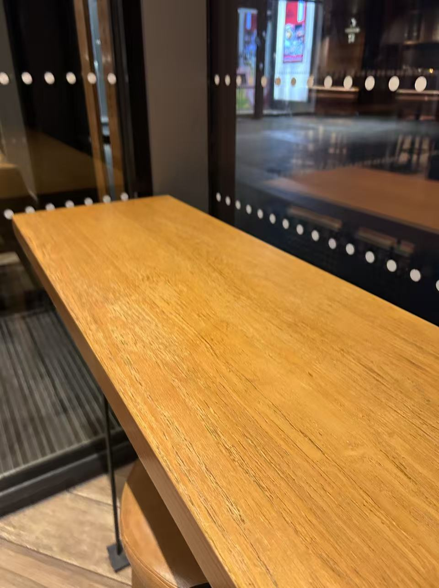
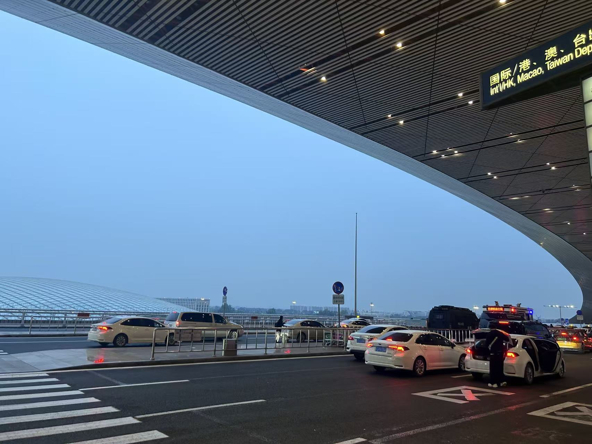

# 终于过去了，难过！

上一次认真写东西竟然都是23年的时候了，真久远啊，除了身体老了外，我的心境、生活好像都没啥起色。

关于工作，本来想着不可能待这么久得，结果马上都工作四年了。其实有一份工资还可以、自己有选择加班与否得权利听起来也是一件很不错的事，但慢慢地把自己一开始的那兴趣、热情几乎要消耗殆尽了，重复、低端的工作流总是那么令人厌恶且没有含金量。

关于感情，我总是把所有的事情都藏在自己心里面，不愿和任何人倾诉。黑暗日子刚开始的时候，我坐在工位上眼泪都能止不住的往外流，但又害怕别人看到，一天要去十几二十次厕所平复；深夜的时候自己n多次在那哭泣，然后带着深深的懊悔失眠，精神状况也越来越差，甚至对同事莫名发脾气（虽然事后道歉）。我一次次审视自己的感情，每次都把所有的压力堆积到自己身上，内心充满无穷的愧疚与懊悔；再后面遇到一个同事对他女朋友死缠烂打，疯了一样得不顾一切去挽回，我在旁边看着真的希望他能成功，能有一个好结局，再就是又一次次加重了自己的负罪感。虽然刷到那种解读或者说是开导被分手人的视频，也会闪过那么一丝念头：别人根本就没认真爱过，玩玩而已的，可每次都被那细节给否决，自己给自己洗脑。失眠的时候给之前室友发消息，室友会反问：真的有那么喜欢吗？我都不知道怎么回答，我在心里也犯嘀咕，到底是自己的不甘还是说什么其他原因呢。随着时间一直推移，我发现事情可能也没那么简单，一次次怀疑，一次次开脱，最后给自己洗脑也洗不下去了。随后更是整宿整宿睡不着觉，一直在心里问为什么？为什么？。可是事实是不随你的主观意志而改变的，人就是这么奇怪，就是这么多样，很多东西是没有为什么的，追问到底也只是刺痛自己而已。虽然我那同事换了工作，去那买完房买完车，结果还是掰了，即使如此真诚也碰到了狗血剧情；其实我一直在想我当时为啥没这么做，一直懊悔，但其实可能幸亏我没那么做，否则狗血的剧情会不会把我逼疯，其实或许那时候我心里已经有个答案，藏在很多细节当中，只是我一直逃避，不敢面对，不敢承认。

关于身体，最近3年去医院次数甚至比我过去25、26年去得都要多很多，内分泌紊乱等等，希望接下来几个月能克服胰岛素抵抗，起码减到5年前的体型。
leave
关于人情世故，我还是一样地“呆”，无论工作、生活还是不想去搞那些事情，顺其自然吧。人生很长，人不会一直好运，也不会一直霉运，保持自己初心，总会有好运到来。

人生是一本仓促的书，向前走而不是停留在过去，Your time is limited.

<!--more-->

